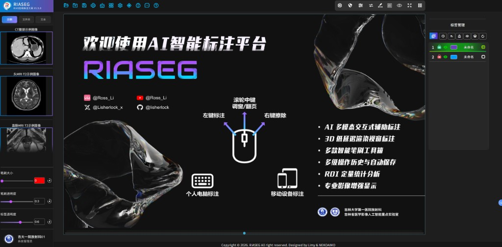

# RIASEG

An intelligent annotation platform for medical imaging, with AI-based fully automatic and semi-automatic segmentation.

  

RIASEG is a browser-based workstation for viewing, annotating, and analyzing CT and MRI. It combines manual tools with fully automatic and interactive segmentation models, and supports multi-planar review with a live 3D ROI view.

## Demo

Watch the related video on Bilibili: [RIASEG demo](https://www.bilibili.com/video/BV177xeeSEdT/)

## Highlights

- **Fully automatic segmentation.** One-click models, including CT muscle, subcutaneous fat (SAT), visceral fat (VAT), and intermuscular fat (IMAT).
- **Semi-automatic segmentation.** Slice-wise CT/MRI models, plus interactive prompts (point, scribble, lasso, and bounding box) through nnInteractive.
- **Multi-view workspace.** Axial, coronal, sagittal, and 3D ROI views, with low-latency 3D rendering.
- **Annotation tools.** Brush, lasso, threshold painting, foreground-only editing, and a boundary-aware smart brush.
- **Labels and review.** Multi-class masks, color and visibility controls, lock, undo history, batch remapping, and mask quality checks.
- **Quantification.** ROI volume and diameter measurements, with radiomics-style analysis.
- **Data.** NIfTI and DICOM, built-in demo series, and paired image and mask folders.
- **AI annotation assistant.** In-app help for the annotation workflow and mask review.

## About

Developed for clinical and research annotation in radiology.

Department of Radiology, The First Hospital of Jilin University  
Jilin Provincial Key Laboratory of Medical Imaging Artificial Intelligence
